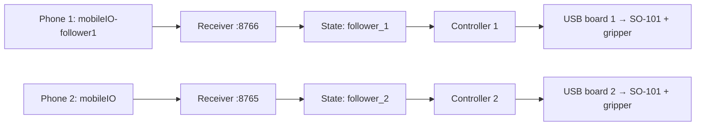

# SO-101 dual-phone teleoperation harness

Control two SO-101 follower arms with two phones running HEBI Mobile I/O.
Each phone controls its own arm and gripper through a Raspberry Pi 5. No
physical leader arm is required, and arm cameras are not used for control.

This is the standalone version of a working two-follower prototype. It includes
the controller, phone receivers, local dashboards, an SO-101 model, and offline
regression tests. Local calibrations, phone identifiers, logs, credentials, and
machine-specific configuration are not included.

## Controls

| Input | Action |
|---|---|
| Hold **B1** and translate the phone | Move that arm's end effector |
| Release **B1** | Hold the arm's current pose; reposition/recenter the phone |
| Move **A3** while holding B1 | Open or close that arm's gripper |
| Dashboard **Pause movement** | Pause while retaining the current pose |
| Dashboard **Release motors and end session** | Disable torque and finish the session after you support the arm |

Hold the phone flat, screen up, with its top pointing forward. Motion is based on
AR position, not just phone tilt. Translation is half scale: 10 cm of phone travel
requests about 5 cm of end-effector travel. Release B1 and center A3 before first
enabling a session.

**Releasing B1 does not turn the motors off.** Ctrl+C and SIGTERM request a pause;
use the dashboard's supported-release action to end a powered session. A hardware
health fault releases torque, so arrange the workspace to accommodate that.

## Two independent channels



The names preserve the prototype's original assignment: `mobileIO` belongs to
`follower_2`, and the additional phone is `mobileIO-follower1`. You can change both
names in configuration. Each arm needs a separate USB motor-controller board;
the two sets of motor IDs 1–6 must not share one serial bus.

Receivers discover an exact family/name pair, bind to that phone's MAC address,
and save the pairing locally. Duplicate names and replacement devices are
rejected. Each receiver, controller, and phone device has an exclusive lock.
Linux serial ports additionally use `TIOCEXCL`. Dashboards write commands only
to their own arm's state directory, and controllers validate phone identity.

## Hardware and software

- Raspberry Pi 5 running 64-bit Linux; Python **3.12**.
- Two SO-101 followers with STS3215 motors, separate USB boards, suitable motor
  power supplies, and **their own saved LeRobot calibrations**.
- Two phones with HEBI Mobile I/O and working AR/camera tracking, on the Pi's LAN.
- This implementation's voltage window is for the tested **12 V kit**. It is not
  a universal configuration for every STS3215 voltage variant.

The harness uses LeRobot's motor bus and Placo kinematics. It does not run a
training policy or use a cloud control service. HEBI SDK/app licensing remains
separate; see [third-party attribution](THIRD_PARTY.md).

## Install

```bash
git clone https://github.com/philipmeng/so101-dual-phone-harness.git
cd so101-dual-phone-harness
python3.12 -m venv .venv
source .venv/bin/activate
python -m pip install --upgrade pip
python -m pip install -r requirements-control.txt
python -m pip install --no-deps lerobot==0.6.1
```

LeRobot is installed separately to avoid bringing in its complete training and
camera stack. The requirements list supplies the dependencies used by this
harness. On systems where Torch's default index selects GPU packages, install
the matching CPU wheel from PyTorch's CPU index first. Native Placo/Torch wheels
must support your architecture; the prototype ran on Linux aarch64.

## Configure the two arms

```bash
cp config.example.toml config.toml
mkdir -p calibration
ls -l /dev/serial/by-id/
```

Edit `config.toml` with the two actual `/dev/serial/by-id/...` paths. Put each
arm's existing calibration JSON in `calibration/follower_1.json` and
`calibration/follower_2.json`. These are LeRobot `MotorCalibration` mappings with
`id`, `drive_mode`, `homing_offset`, `range_min`, and `range_max` for all six named
motors. Use the calibration from that physical arm. The controller checks that
the motor registers match it; this project does not calibrate or rewrite offsets.

Calibration/setup guidance is available in the
[official LeRobot SO-101 documentation](https://huggingface.co/docs/lerobot/so101).
Configuration paths resolve relative to the TOML file, so the installation can
live anywhere. State and pairing files stay under the configured `state_dir`.

Set the phones as follows, keep HEBI open, and enable AR/camera tracking and local
network access where required:

| Arm | HEBI family | HEBI name | Dashboard |
|---|---|---|---|
| follower_1 | HEBI | mobileIO-follower1 | http://127.0.0.1:8766/ |
| follower_2 | HEBI | mobileIO | http://127.0.0.1:8765/ |

Do not run another receiver on a laptop for the same phones. Check that another
robot service is not scanning the two arm ports; see [USB ownership](docs/operations.md#usb-ownership).

## Check and start

Mount both bases firmly and clear the movement areas, including the space between
the arms. Start with the motors off and support the arms during setup. The
`--base-clamped-sweep-clear` flag acknowledges this physical setup.

With no controller owning either port, check each arm:

```bash
python tools/check_arm.py --robot-id follower_1
python tools/check_arm.py --robot-id follower_2
```

This reads calibration, torque state, health, pose, and position gains without
enabling motors. It also checks whether the current pose lies inside the movement
margin. Reports are written to `.state/<robot_id>/preflight.json`.

The working prototype used **P=32 on shoulder_lift and elbow_flex**, with D=32
and I=0. P=16 combined with small command lead stalled upward movement under load.
To explicitly apply the tested P setting while motors are off:

```bash
python tools/check_arm.py --robot-id follower_1 --set-lift-gain 32
python tools/check_arm.py --robot-id follower_2 --set-lift-gain 32
```

This changes only those two P settings and the EEPROM write lock; it verifies the
writes and rolls back the P settings on failure. The adjustment is volatile and
may reset after motor power cycling. It does not raise output or protection limits.
Do not run this tool while a controller owns the port.

Start the four processes in separate terminals, all from the repository root
with the virtual environment active:

```bash
# Terminal 1: phone receiver and dashboard for follower_1
python -u harness/phone_input_preview.py --robot-id follower_1

# Terminal 2: phone receiver and dashboard for follower_2
python -u harness/phone_input_preview.py --robot-id follower_2

# Terminal 3: motor controller for follower_1
python -u harness/phone_control.py --robot-id follower_1 --base-clamped-sweep-clear

# Terminal 4: motor controller for follower_2
python -u harness/phone_control.py --robot-id follower_2 --base-clamped-sweep-clear
```

All commands accept `--config /path/to/config.toml`. Motor controllers start with
torque off and require a fresh B1 release/press. If a phone is disconnected, its
controller waits. Start with small movements, one arm at a time, then use both.

Dashboards bind to localhost. To view them from another computer, forward both
ports over your existing SSH connection:

```bash
ssh -N -L 8765:127.0.0.1:8765 -L 8766:127.0.0.1:8766 USER@PI_HOST
```

## What made this harness work

- **Plan from commanded joint positions.** Replanning every short IK step from
  measured shoulder sag caused the desired path itself to drift downward.
- **Pace from actual feedback.** Joint goals stay within 32 ticks of measured
  positions, beneath the independent 40-tick tracking fault.
- **Pace the gripper separately.** A shoulder waiting for feedback no longer
  freezes all A3 commands.
- **Use suitable position gain.** The tested shoulder/elbow P=32 setting improved
  lift response without raising torque caps.
- **Keep ownership explicit.** Each phone, dashboard, state directory, USB board,
  and calibration belongs to one arm.

## Limits and current status

This is supervised prototype control. It uses positional IK and joint limits;
it does **not** provide obstacle avoidance, inter-arm collision avoidance, force
control, or calibrated Cartesian accuracy. B1 defines a new motion reference
each time it is pressed. Gripper commands also pause when the IK target is
unreachable; release B1 and recenter in that case.

The controller retains temperature, current, voltage, calibration, torque-state,
and tracking checks. Some prototype runs reported isolated high temperature
packets followed by normal readings. Their cause is unresolved. Readings at the
hardware threshold still end motion and release torque; the code does not filter
them away or automatically rearm. See [operation and troubleshooting](docs/operations.md).

The original installation was tested with six responding motors per arm,
matched calibrations, independent phones, and live teleoperation. The public
packaging adds configuration and offline tests; it is not an endurance or
collision-safety certification.

## Tests

```bash
PYTHONPATH=harness python -m unittest discover -s tests -v
```

Tests never open robot serial ports or subscribe to a phone. They cover button
transitions, feedback/thermal faults, command pacing, upward motion with simulated
shoulder lag, gripper independence, profile isolation, device locks, configuration
validation, and gain-adjustment rollback. Kinematic tests use synthetic calibration
data and the bundled upstream SO-101 model.

An optional GitHub Actions workflow is supplied at `ci/github-actions.yml`.
To enable it, copy it to `.github/workflows/tests.yml` and commit using a credential
authorized to modify workflows. It is a template rather than an active workflow
in this initial publication.

## License

Harness code: [MIT](LICENSE). Bundled SO-101 model: Apache-2.0, with its upstream
license and provenance retained. See [THIRD_PARTY.md](THIRD_PARTY.md).
